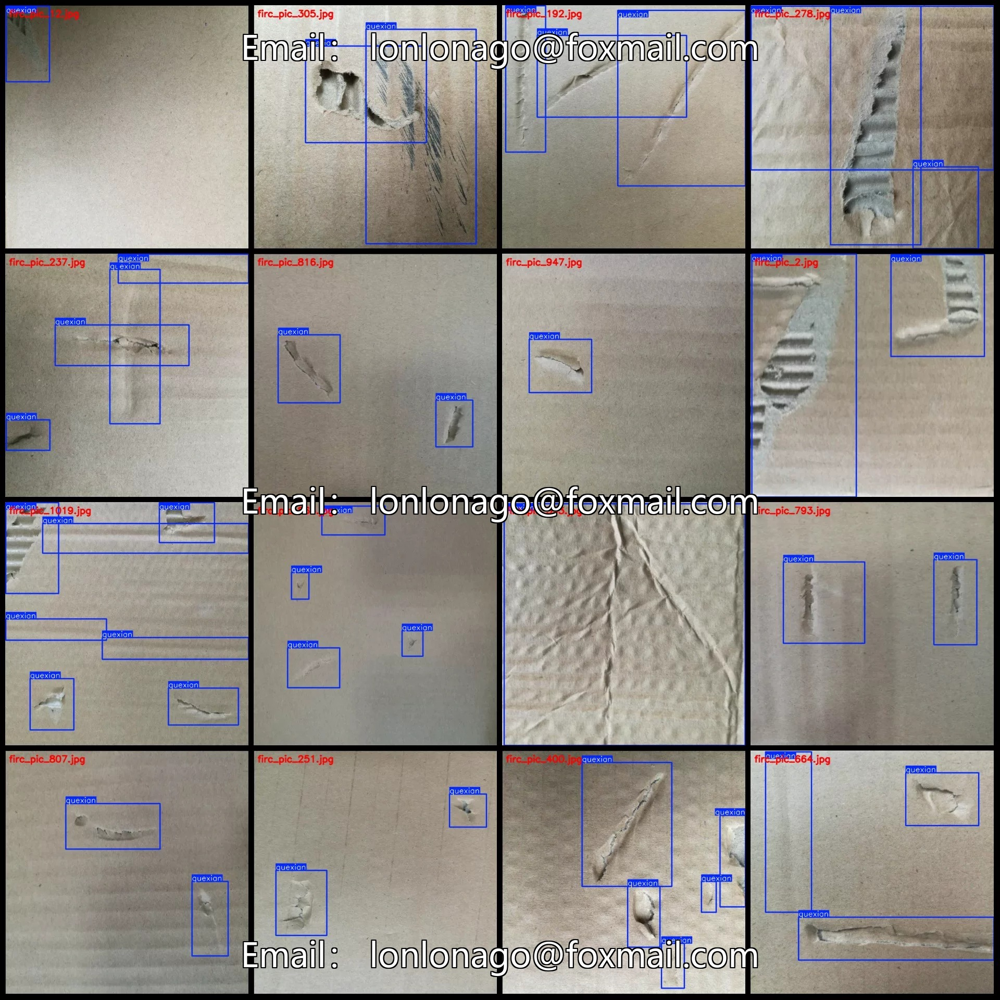
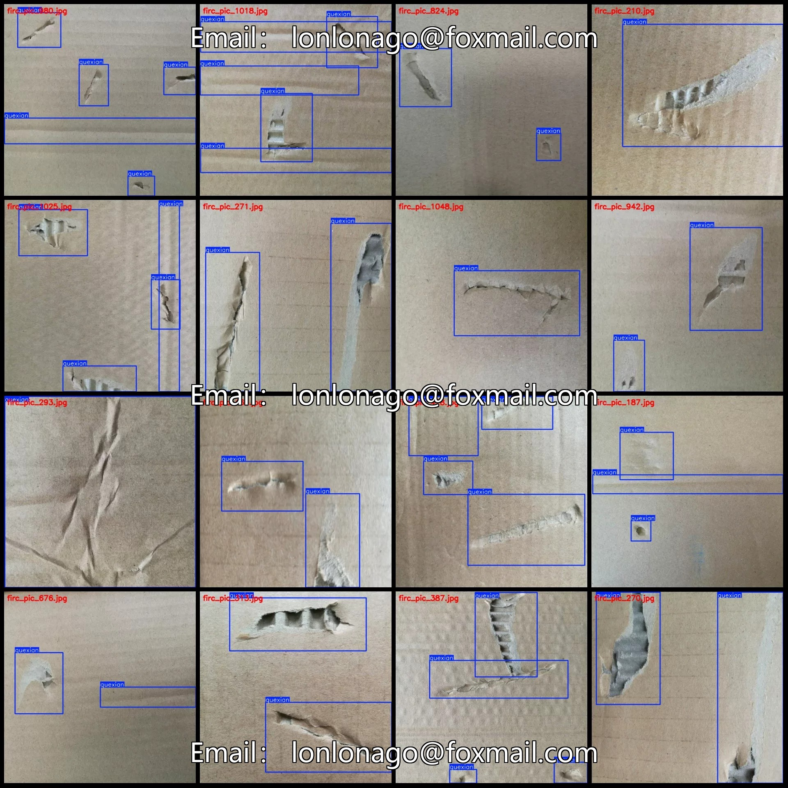
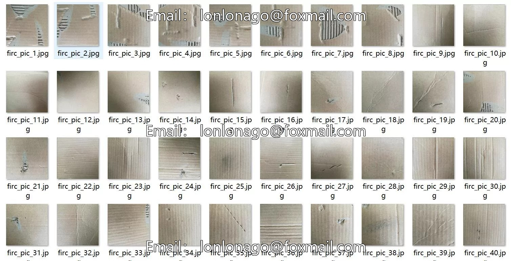
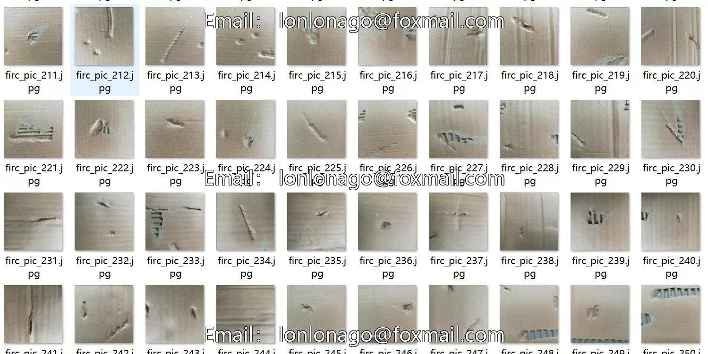

# Paperboard Defects and Cardboard Surface Defects Detection Dataset in VOC+YOLO format, 1055 images

## Body

Paperboard Defects and Cardboard Surface Defects Detection Dataset in VOC+YOLO format with 1055 images in 1 category
Warm reminder: Due to the dataset's replicability, please confirm compliance before purchasing.
Dataset format: Pascal VOC format + YOLO format (txt file without split path, only contains jpg images and corresponding VOC format xml files and yolo format txt files)
Number of images (number of jpg files): 1055
Number of annotations (number of xml files): 1055
Number of annotations (number of txt files): 1055
Label category count: 1
Label category name: ["quexian"]
Number of boxes and the number of images occupied by each category

Quexian Frames = 2866, Pictures Count = 1055
Total Frames: 2866
Image Resolution: 640x640
Labeling Tool: labelImg
Labeling Rules: Draw a rectangle around the category.
Important Notice: The dataset does not have separate training, validation, and test sets; you need to partition them yourself.
Special Remark: This dataset does not guarantee the accuracy of the trained models or weight files.

## Images

## Payment

Here is a pay link on Stripe ( https://buy.stripe.com/3cs8yP7sY87d0vu9AB ). Please contact me lonlonago@foxmail.com after funding $89, and I will send you a complete data files , thank you!

